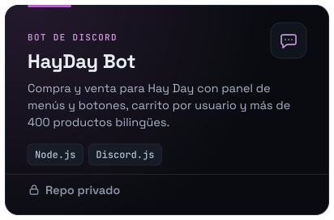
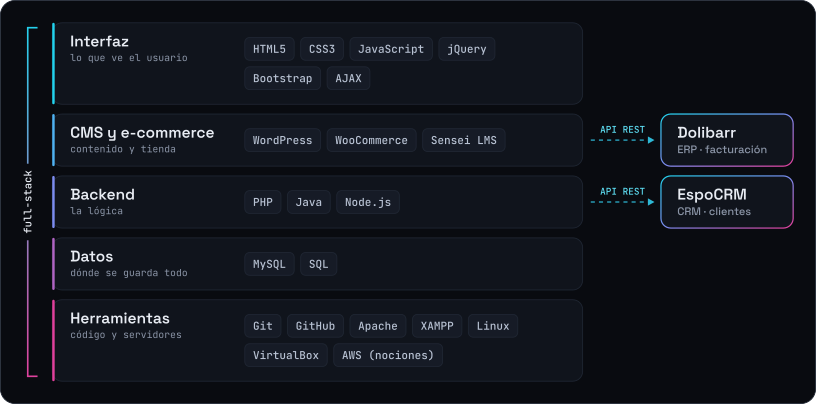

  <a href="https://cv-online-danielnavarro.vercel.app">
    <picture>
      <source media="(max-width: 767px)" srcset="https://raw.githubusercontent.com/DanielNavarroFernandez/DanielNavarroFernandez/main/assets/banner-m.svg">
      
    </picture>
  </a>

  
  &nbsp;
  
  &nbsp;
  
  &nbsp;
  

  <a href="https://cv-online-danielnavarro.vercel.app/#contacto">
    <picture>
      <source media="(max-width: 767px)" srcset="https://raw.githubusercontent.com/DanielNavarroFernandez/DanielNavarroFernandez/main/assets/status-m.svg">
      
    </picture>
  </a>

<h3 align="center"></h3>

  <a href="https://cv-online-danielnavarro.vercel.app/#sobre-mi">
    <picture>
      <source media="(max-width: 767px)" srcset="https://raw.githubusercontent.com/DanielNavarroFernandez/DanielNavarroFernandez/main/assets/terminal-m.svg">
      
    </picture>
  </a>

  Acabo de terminar el Grado Superior en <b>Desarrollo de Aplicaciones Web</b>, después del de Multiplataforma. 
  Me gusta llevar cada problema de principio a fin y dejarlo funcionando en producción. 
  Aprendo rápido y por mi cuenta, y quiero especializarme en <b>ciberseguridad</b>.

  <b>In English:</b> junior full-stack developer based in Madrid. PHP, JavaScript, WordPress and REST API integrations with ERPs and CRMs. Open to on-site and remote roles.

<h3 align="center"></h3>

  <a href="https://cv-online-danielnavarro.vercel.app/#experiencia">
    <picture>
      <source media="(max-width: 767px)" srcset="https://raw.githubusercontent.com/DanielNavarroFernandez/DanielNavarroFernandez/main/assets/featured-m.svg">
      
    </picture>
  </a>
  
  
  
  

  Código en GitHub: <a href="https://github.com/DanielNavarroFernandez/TFGDawDanielNavarro">TFG Alcántara Barbershop</a> · <a href="https://github.com/DanielNavarroFernandez/cv-online-danielnavarro">cv-online</a>

<h3 align="center"></h3>

  

  <a href="https://cv-online-danielnavarro.vercel.app/#stack">
    <picture>
      <source media="(max-width: 767px)" srcset="https://raw.githubusercontent.com/DanielNavarroFernandez/DanielNavarroFernandez/main/assets/stack-m.svg">
      
    </picture>
  </a>

<h3 align="center"></h3>

  <a href="https://cv-online-danielnavarro.vercel.app/#experiencia">
    <picture>
      <source media="(max-width: 767px)" srcset="https://raw.githubusercontent.com/DanielNavarroFernandez/DanielNavarroFernandez/main/assets/timeline-m.svg">
      
    </picture>
  </a>

<h3 align="center"></h3>

  <a href="https://github.com/DanielNavarroFernandez?tab=repositories">
    <picture>
      <source media="(prefers-color-scheme: dark)" srcset="https://raw.githubusercontent.com/DanielNavarroFernandez/DanielNavarroFernandez/output/github-snake-dark.svg">
      <source media="(prefers-color-scheme: light)" srcset="https://raw.githubusercontent.com/DanielNavarroFernandez/DanielNavarroFernandez/output/github-snake.svg">
      
    </picture>
  </a>

  <a href="mailto:d.navarrofernandez@gmail.com">
    <picture>
      <source media="(max-width: 767px)" srcset="https://raw.githubusercontent.com/DanielNavarroFernandez/DanielNavarroFernandez/main/assets/footer-m.svg">
      
    </picture>
  </a>

